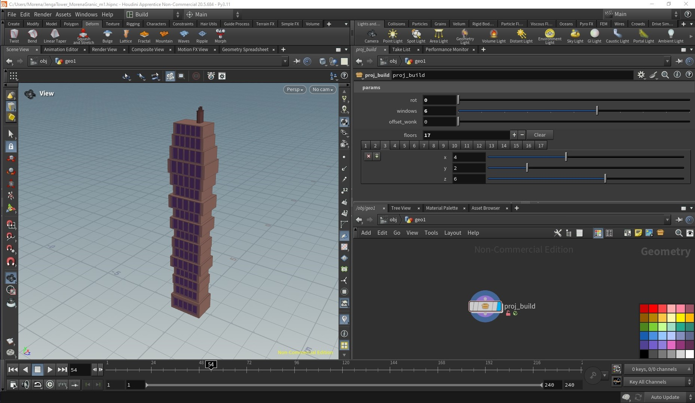
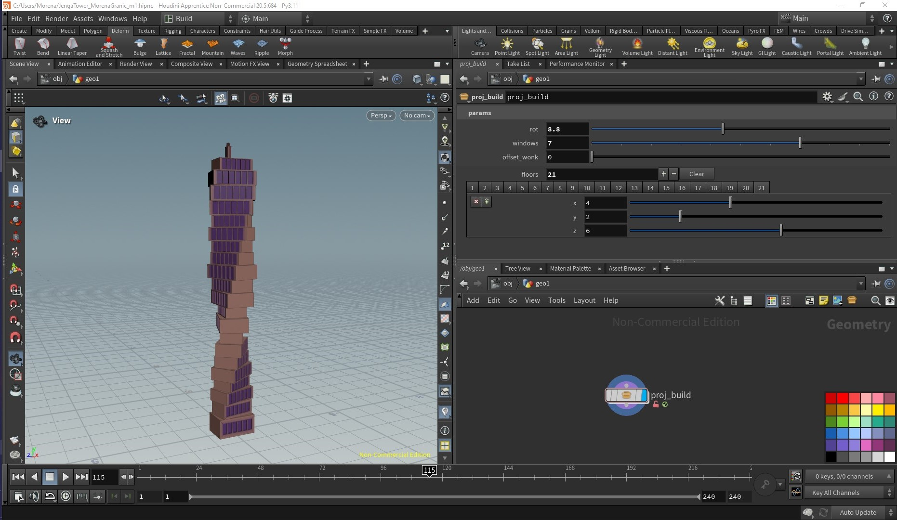
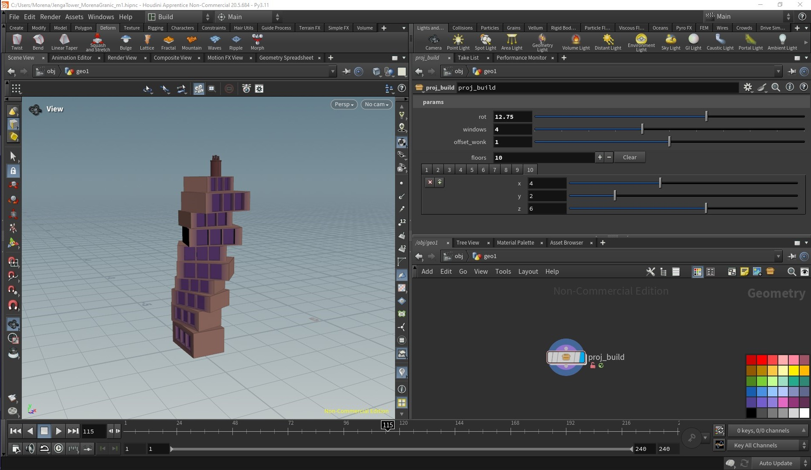
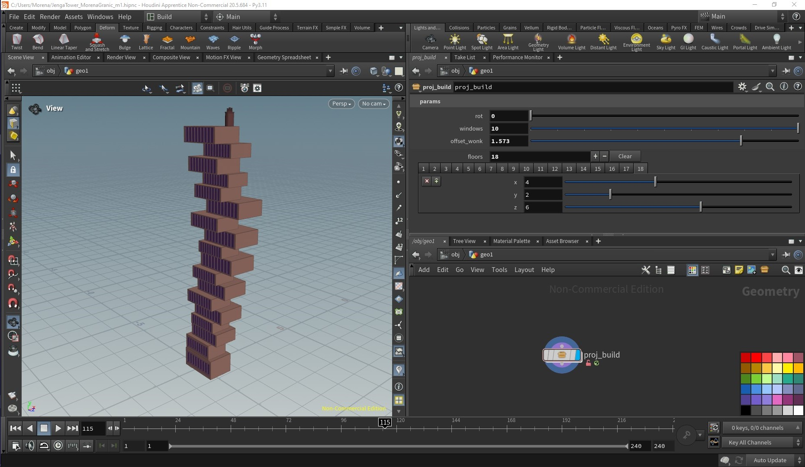
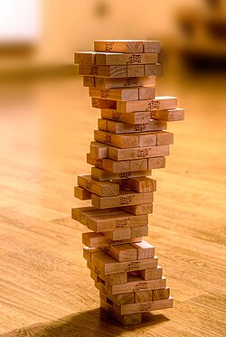
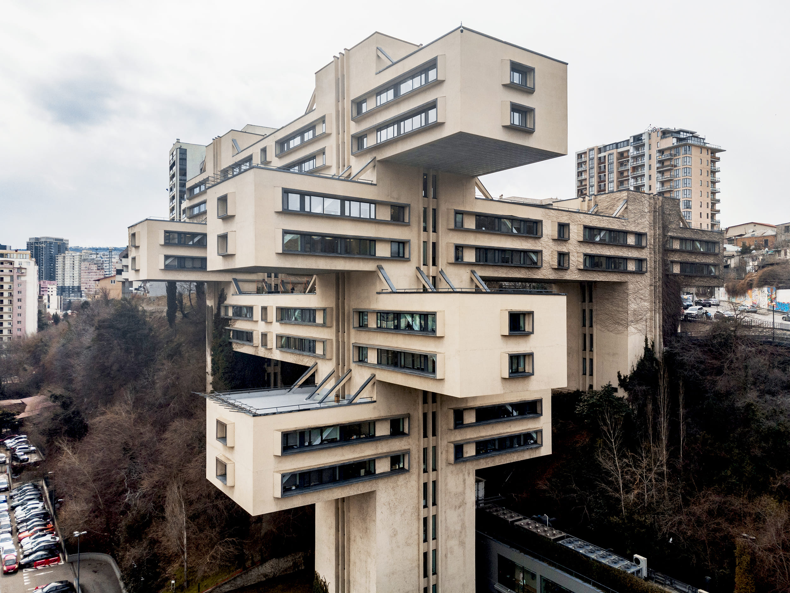
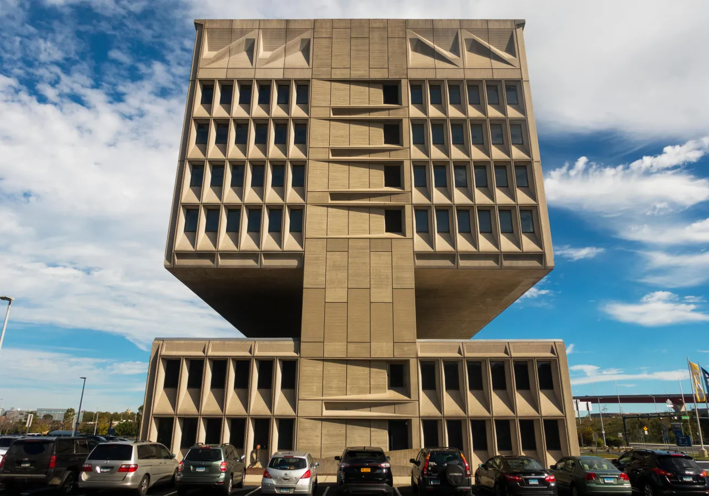

## Milestone 1 report

Zgrada je stvorena kao SOP digital asset, sa 7 promjenjivih parametara:
* floors - broj katova
* x, y, z - dimenzije svakog kata
* rot - kut pomaka rotacije svakog kata (određuje uvrnutost zgrade)
* windows - broj prozora na stranama katova
* offset wonk - određuje koliko se svaki kat pomiče u odnosu na kat ispod

Moguće je postići dosta različite izglede podešavanjem ovih parametara, neki od njih vidljivi su među screenshotovima.

Osnovna struktura zgrade s podesivim katovima koji se slažu jedan na drugi stvorena je praćenjem navedenog tutoriala: https://www.youtube.com/watch?v=uIe97023sDk. Korištenjem for petlje može se stvoriti proizvoljan broj katova, a svaki od njih ima svoje parametre dimenzije. 

Sama zgrada nema puno detalja, po uzoru na brutalističku arhitekturu, pa joj svu zanimljivost daje oblik. Svaki kat inicijano ima jednaku osnovnu veličinu, ali nasumično se skaliraju unutar nekog raspona za malo varijacije. Osim toga, svaki kat se i rotira za konstantan broj stupnjeva (određen parametrom rot) u odnosu na kat ispod sebe, što se s većim brojem katova akumulira u spiralni oblik zgrade. Rezultat izgleda kao visoka hrpa knjiga ili Jenga toranj, odakle i naziv projekta. Jedini detalj na katovima su prozori, postignuti Boolean razlikom sa kvadrovima skaliranim da ispune prostor oviseći o tome koliko ih je. Na vrhu zgrade je i dimnjak izmodeliran u Houdiniju te dodan kao asset.

## Screenshots

1. visoka zgrada s 5 prozora po katu, bez wonka i rotacije

2. visoka zgrada sa 6 prozora po katu, bez wonka, umjerena rotacija

3. niska zgrada s 3 prozora po katu, osrednji wonk, snažna rotacija

4. visoka zgrada s 9 prozora po katu, snažan wonk, bez rotacije

## Inspo

5. Jenga

6. hrpa knjiga

7. brutalizam
